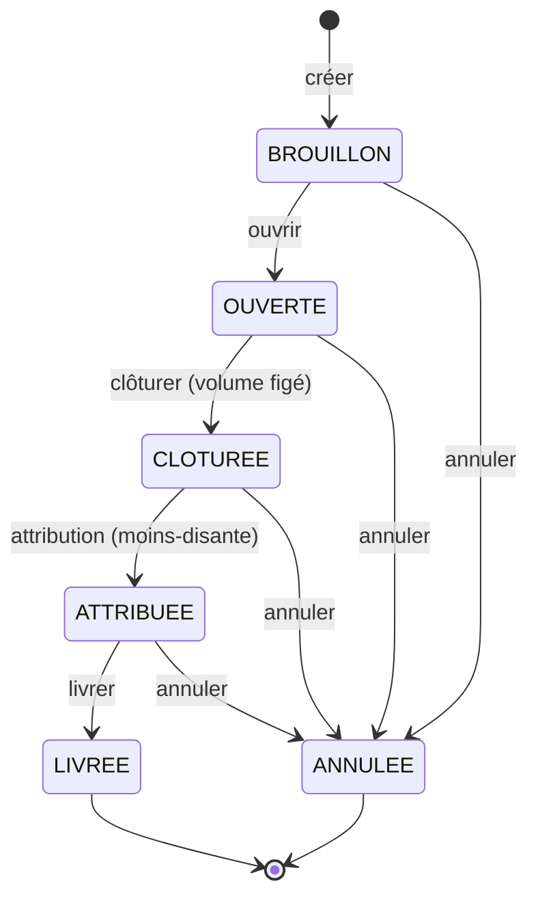
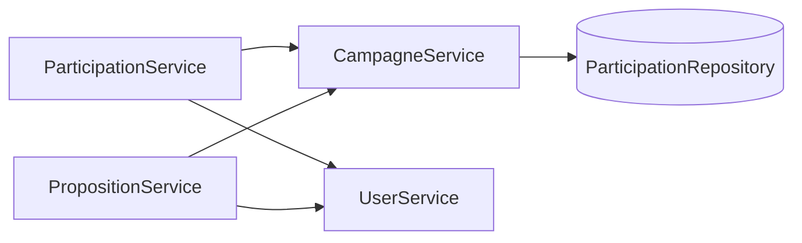
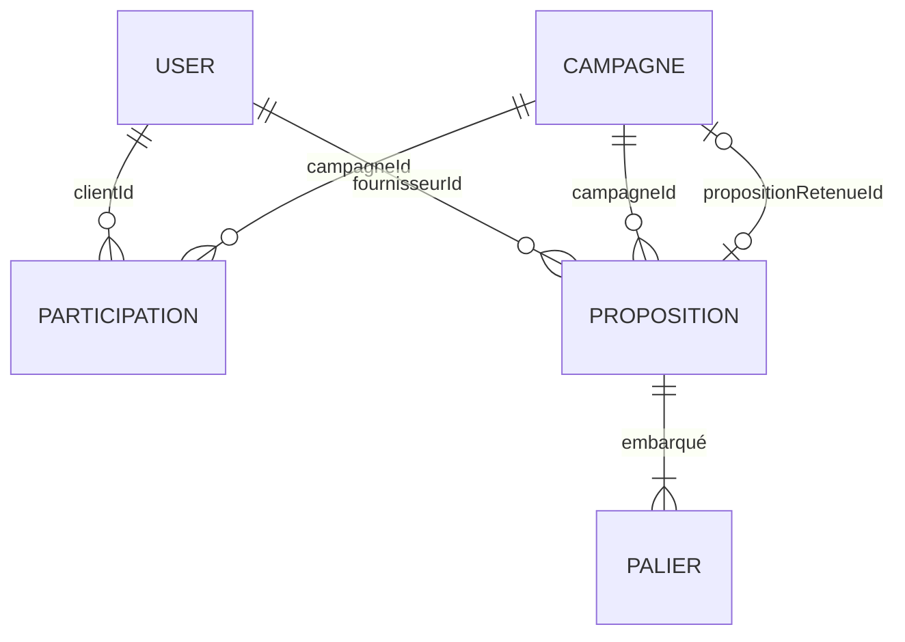

# Gestion Fioul — commandes groupées de fioul

API REST de **commandes groupées de fioul domestique**. Des clients s'engagent sur un volume dans une *campagne*,
des fournisseurs répondent par un *barème dégressif par paliers de volume*, et la plateforme retient
automatiquement la proposition la moins chère pour le volume total réuni.

Projet d'apprentissage (BTS SIO, option SLAM — préparation Spring), construit pas à pas, classe par classe,
avec une organisation **par fonctionnalités** (et non par couches techniques).

---

## Sommaire

1. [Principe métier](#1-principe-métier)
2. [Stack technique](#2-stack-technique)
3. [Démarrage rapide](#3-démarrage-rapide)
4. [Configuration](#4-configuration)
5. [Architecture du code](#5-architecture-du-code)
6. [Modèle de données](#6-modèle-de-données)
7. [Règles métier](#7-règles-métier)
8. [Sécurité](#8-sécurité)
9. [API REST](#9-api-rest)
10. [Exemple de parcours complet (curl)](#10-exemple-de-parcours-complet-curl)
11. [Documentation Swagger](#11-documentation-swagger)
12. [Docker Compose](#12-docker-compose)
13. [Tests](#13-tests)
14. [Décisions de conception](#14-décisions-de-conception)
15. [Limites connues et pistes d'amélioration](#15-limites-connues-et-pistes-daméliorations)
16. [Dépannage](#16-dépannage)
17. [Historique de construction](#17-historique-de-construction)

---

## 1. Principe métier

### Les acteurs

Un seul type de compte (`User`) porte un **rôle** :

| Rôle | Qui | Ce qu'il fait |
|---|---|---|
| `CLIENT` | un particulier ou une entreprise qui achète du fioul | participe à une campagne en déclarant un volume (en litres) |
| `FOURNISSEUR` | un distributeur de fioul | soumet un barème de prix par paliers de volume |
| `ADMIN` | l'organisateur de la plateforme | crée, ouvre, clôture, attribue et livre les campagnes |

### Le mécanisme des paliers

Un fournisseur propose **à l'avance**, pendant que la campagne est ouverte, un barème dégressif :

| Palier | Volume | Prix au litre |
|---|---|---|
| 1 | de 0 à 5 000 L | 1,10 € |
| 2 | de 5 000 à 15 000 L | 1,05 € |
| 3 | à partir de 15 000 L | 1,00 € |

À la clôture, le volume total de la campagne est connu et figé. Pour chaque proposition, on lit le prix du palier
qui contient ce volume total ; la moins-disante est retenue.

> **Le tarif s'applique à tout le volume**, il n'est pas calculé tranche par tranche. Avec 8 000 L au total et le
> barème ci-dessus, les 8 000 L sont facturés 1,05 € (et non 5 000 L à 1,10 € puis 3 000 L à 1,05 €).
> Les bornes sont : minimum **inclus**, maximum **exclu** (5 000 L tombe dans le palier 2).

### Cycle de vie d'une campagne



| Statut | Signification |
|---|---|
| `BROUILLON` | créée, invisible des participants, pas encore ouverte |
| `OUVERTE` | les clients participent, les fournisseurs proposent |
| `CLOTUREE` | date limite passée ou clôture manuelle ; `volumeTotal` figé |
| `ATTRIBUEE` | une proposition est retenue (`propositionRetenueId` renseigné) |
| `LIVREE` | livraison effectuée |
| `ANNULEE` | abandonnée (possible sauf si déjà `LIVREE` ou `ANNULEE`) |

---

## 2. Stack technique

| Élément | Version / choix |
|---|---|
| Langage | Java **27** |
| Framework | Spring Boot **4.1.1** (Spring Framework 7) |
| Web | `spring-boot-starter-webmvc` (API REST, Jackson 3) |
| Base de données | MongoDB **8.0.9** via `spring-boot-starter-data-mongodb` |
| Sécurité | Spring Security — **HTTP Basic**, sessions désactivées, mots de passe **BCrypt** |
| Documentation | springdoc-openapi **3.1.1** (Swagger UI) |
| Planification | Spring Scheduling (`@EnableScheduling` / `@Scheduled`) — clôture automatique des campagnes échues |
| Conteneurs | Docker Compose (MongoDB + mongo-express) |
| Tests | JUnit 6, Mockito 5.23, AssertJ, Spring Security Test, **Testcontainers 2.0.5**, **Awaitility 4.3.0** |
| Build | Maven (wrapper `mvnw` fourni) |

Choix volontaires : **pas de Lombok** (getters/setters écrits à la main), **DTO en `record`**, injection par
constructeur, exceptions Java standard traduites en HTTP par un gestionnaire global.

---

## 3. Démarrage rapide

### Prérequis

- **JDK 27** (la propriété `java.version` du `pom.xml` vaut 27)
- **Docker** avec Docker Compose (pour MongoDB, et pour les tests Testcontainers : bout en bout et scheduling)
- Aucune installation Maven nécessaire : utiliser `mvnw` / `mvnw.cmd`

### 1. Démarrer MongoDB

```bash
docker compose up -d
```

Le compose crée deux conteneurs (voir [§12](#12-docker-compose)) :
MongoDB sur `localhost:27018` et l'interface web mongo-express sur http://localhost:8083.

### 2. Lancer l'application

```bash
./mvnw spring-boot:run          # Linux / macOS / Git Bash
mvnw.cmd spring-boot:run        # Windows (cmd / PowerShell)
```

L'application écoute sur **http://localhost:9999**. Elle peut aussi être lancée depuis l'IDE via la classe
`GestionfioulApplication`.

### 3. Se connecter

Au démarrage, un compte **administrateur** est créé s'il n'existe pas :

| | |
|---|---|
| Email | `admin@gestionfioul.local` |
| Mot de passe | valeur de la variable d'environnement `ADMIN_PASSWORD`, **`12345678` à défaut** |

> ⚠️ Le mot de passe par défaut `12345678` est prévu pour le développement uniquement (voir [§15](#15-limites-connues-et-pistes-daméliorations)).

### 4. Explorer l'API

- Swagger UI : http://localhost:9999/swagger-ui.html
- Interface MongoDB : http://localhost:8083

### Arrêter

```bash
docker compose down       # arrête, conserve les données (volume mongo-data)
docker compose down -v    # arrête ET efface les données
```

---

## 4. Configuration

Fichier : `src/main/resources/application.properties`.

| Propriété | Valeur | Rôle |
|---|---|---|
| `server.port` | `9999` | port de l'API |
| `spring.mongodb.uri` | `mongodb://${MONGO_USER:root}:${MONGO_PASSWORD:root}@localhost:${MONGO_PORT:27018}/gestionfioul?authSource=admin` | connexion à MongoDB (base `gestionfioul`) |
| `spring.data.mongodb.auto-index-creation` | `true` | **nécessaire** pour créer l'index unique sur l'email |
| `gestionfioul.admin.email` | `admin@gestionfioul.local` | email du compte admin créé au démarrage |
| `gestionfioul.admin.password` | `${ADMIN_PASSWORD:12345678}` | mot de passe de l'admin ; **vide = aucun admin créé** |
| `gestionfioul.campagnes.cloture-automatique.intervalle-ms` | `300000` (5 min) | fréquence à laquelle `CampagneScheduler` clôture les campagnes échues |

### Variables d'environnement

Les mêmes noms et valeurs par défaut sont utilisés par `docker-compose.yml` et par l'application, pour rester cohérents.

| Variable | Défaut | Utilisée par |
|---|---|---|
| `MONGO_USER` | `root` | compose + application |
| `MONGO_PASSWORD` | `root` | compose + application |
| `MONGO_PORT` | `27018` | compose + application (port hôte de MongoDB) |
| `MONGO_EXPRESS_PORT` | `8083` | compose (port hôte de mongo-express) |
| `ADMIN_PASSWORD` | `12345678` | application (mot de passe de l'admin créé au démarrage) |

Exemple :

```bash
ADMIN_PASSWORD='UnMotDePasseSolide!' MONGO_PASSWORD='autre' docker compose up -d
```

> Si vous changez `MONGO_USER`, `MONGO_PASSWORD` ou `MONGO_PORT`, définissez les **mêmes** valeurs pour
> l'application. Un mot de passe déjà initialisé dans le volume `mongo-data` n'est pas modifié par un simple
> redémarrage : utilisez `docker compose down -v` pour repartir de zéro.

---

## 5. Architecture du code

Organisation **par fonctionnalités** : chaque dossier regroupe tout ce qui concerne un sujet
(document, repository, service, contrôleur, DTO, enums), du modèle jusqu'à l'API.

```
src/main/java/fr/limoges/valadon/gestionfioul
├─ GestionfioulApplication
│
├─ user/                       comptes et rôles
│   ├─ User                       document MongoDB
│   ├─ Role                       ADMIN | CLIENT | FOURNISSEUR
│   ├─ UserRepository
│   ├─ UserService                inscription, hachage du mot de passe
│   ├─ UserController             POST /api/users, GET /api/users/{id}
│   ├─ InscriptionRequest         DTO d'entrée (record)
│   └─ UserResponse               DTO de sortie, sans mot de passe (record)
│
├─ campagne/                   cycle de vie des campagnes
│   ├─ Campagne, StatutCampagne
│   ├─ CampagneRepository
│   ├─ CampagneService            créer, ouvrir, clôturer, attribuer, livrer, annuler
│   ├─ CampagneScheduler          @Scheduled : clôture automatique des campagnes échues
│   ├─ CampagneController
│   └─ CreerCampagneRequest
│
├─ participation/              engagement des clients
│   ├─ Participation, StatutParticipation
│   ├─ ParticipationRepository
│   ├─ ParticipationService       participer, annuler
│   ├─ ParticipationController
│   └─ ParticiperRequest
│
├─ proposition/                offres des fournisseurs
│   ├─ Proposition, StatutProposition
│   ├─ Palier                     objet embarqué (tranche de volume + prix)
│   ├─ PropositionRepository
│   ├─ PropositionService         soumettre, validation des paliers, choix de la moins-disante
│   ├─ PropositionController
│   └─ SoumettrePropositionRequest
│
├─ security/                   authentification et autorisations
│   ├─ SecurityConfig             chaîne de filtres, BCrypt, @EnableMethodSecurity
│   ├─ UtilisateurConnecte        principal Spring Security (porte l'id de l'utilisateur)
│   ├─ UtilisateurDetailsService  charge un utilisateur par email
│   └─ AdminInitializer           crée l'admin au démarrage
│
└─ common/                     éléments transverses
    ├─ GestionExceptionHandler    exceptions -> réponses HTTP (ProblemDetail)
    └─ OpenApiConfig              métadonnées Swagger et schéma d'authentification
```

### Dépendances entre fonctionnalités



- Les features se référencent **par identifiant** (`String campagneId`, `String clientId`…), jamais par objet :
  voir [§14](#14-décisions-de-conception).
- `CampagneService` lit `ParticipationRepository` pour calculer le volume à la clôture ; le sens inverse n'existe
  pas, il n'y a donc **aucun cycle** entre beans.
- Flux d'une requête : `Contrôleur` (sécurité + DTO) → `Service` (règles métier) → `Repository` (MongoDB).

---

## 6. Modèle de données

Quatre collections MongoDB, base `gestionfioul`.



### `users`

| Champ | Type | Remarque |
|---|---|---|
| `id` | String | généré par MongoDB |
| `email` | String | **index unique**, stocké en minuscules |
| `motDePasse` | String | haché BCrypt (`$2a$10$…`) |
| `nom`, `prenom`, `telephone` | String | |
| `role` | `Role` | `ADMIN`, `CLIENT`, `FOURNISSEUR` |
| `adresse` | String | livraison (client) ou siège (fournisseur) |
| `raisonSociale` | String | fournisseur uniquement, `null` pour un client |

### `campagnes`

| Champ | Type | Remarque |
|---|---|---|
| `id` | String | |
| `libelle` | String | ex. « Commande groupée janvier » |
| `dateOuverture`, `dateCloture` | LocalDateTime | `dateCloture` = date limite de participation |
| `statut` | `StatutCampagne` | `BROUILLON` par défaut |
| `volumeTotal` | int | litres ; **0 tant que la campagne n'est pas clôturée** |
| `zoneLivraison` | String | code postal, secteur… (informatif) |
| `propositionRetenueId` | String | renseigné à l'attribution |

### `participations`

| Champ | Type | Remarque |
|---|---|---|
| `campagneId` | String | index |
| `clientId` | String | index |
| `volumeSouhaite` | int | litres, strictement positif |
| `adresseLivraison` | String | par défaut, celle du profil du client |
| `statut` | `StatutParticipation` | `CONFIRMEE` ou `ANNULEE` |
| `dateParticipation` | LocalDateTime | |

### `propositions`

| Champ | Type | Remarque |
|---|---|---|
| `campagneId` | String | index |
| `fournisseurId` | String | index |
| `dateProposition` | LocalDateTime | sert au départage à prix égal |
| `validiteJusqua` | LocalDateTime | doit dépasser la clôture de la campagne |
| `statut` | `StatutProposition` | `SOUMISE`, `RETENUE`, `REJETEE` |
| `paliers` | `List<Palier>` | **embarqués** dans le document |

Un `Palier` : `volumeMin` (int, inclus), `volumeMax` (Integer, exclu, `null` = sans limite), `prixLitre` (BigDecimal).

> Les index ne sont créés que si `spring.data.mongodb.auto-index-creation=true` (déjà configuré). Un test de bout
> en bout vérifie que l'index unique sur l'email existe réellement.

---

## 7. Règles métier

Elles sont implémentées dans les **services** (et couvertes par les tests unitaires).

### Utilisateurs (`UserService`)
- Email obligatoire, **normalisé** (espaces retirés, minuscules), **unique**.
- Mot de passe d'au moins **8 caractères**, stocké **haché en BCrypt**.
- Rôle obligatoire ; un `FOURNISSEUR` doit avoir une `raisonSociale` ; pour un `CLIENT`, elle est effacée.
- Le rôle `ADMIN` **ne peut pas être demandé** via l'API publique (refusé par le contrôleur).

### Campagnes (`CampagneService`)
- Création : libellé, dates obligatoires, clôture **strictement postérieure** à l'ouverture. Statut, volume et
  proposition retenue sont **forcés** (`BROUILLON`, 0, `null`) quoi que contienne la requête.
- Ouverture : depuis `BROUILLON` uniquement, et seulement si la date de clôture n'est pas passée.
- Clôture : depuis `OUVERTE` uniquement ; **recalcule** `volumeTotal` = somme des participations `CONFIRMEE`
  (les annulées sont exclues), puis le fige.
- `cloturerCampagnesEchues()` clôture toutes les campagnes `OUVERTE` dont la date limite est passée. Elle est
  déclenchée automatiquement par `CampagneScheduler` (voir ci-dessous) ; elle reste aussi appelable directement.
- Attribution : depuis `CLOTUREE` uniquement ; livraison : depuis `ATTRIBUEE` uniquement.
- Annulation : impossible si `LIVREE` ou déjà `ANNULEE`.
- Toute transition depuis un mauvais statut lève une `IllegalStateException` (→ HTTP 409).

### Participations (`ParticipationService`)
- Réservé aux utilisateurs de rôle `CLIENT`.
- Volume **strictement positif**.
- La campagne doit être `OUVERTE` **et** sa date limite non dépassée (le test de date est nécessaire car une campagne
  peut rester `OUVERTE` un moment après sa date limite, tant que la clôture n'a pas tourné).
- **Une seule participation `CONFIRMEE` par client et par campagne.** Pour changer de volume : annuler puis recréer.
- Adresse de livraison vide → reprise de l'adresse du profil.
- Annulation : uniquement **sa propre** participation, si elle est `CONFIRMEE` et si la campagne est encore ouverte.

### Propositions (`PropositionService`)
- Réservé aux utilisateurs de rôle `FOURNISSEUR`.
- La campagne doit être `OUVERTE` et sa date limite non dépassée.
- `validiteJusqua` doit être **strictement postérieure** à la clôture (sinon la proposition serait périmée au moment
  d'attribuer).
- **Une seule proposition `SOUMISE` par fournisseur et par campagne.**
- Barème de paliers valide : il doit **commencer à 0 L**, se suivre **sans trou ni chevauchement**, **finir sans limite
  haute**, chaque palier ayant un `volumeMax` supérieur à son `volumeMin` et un prix **strictement positif**.
  Les paliers sont triés avant enregistrement.

### Attribution (`PropositionService.retenirMeilleure`)
1. La campagne doit être `CLOTUREE` et avoir un `volumeTotal` > 0.
2. Les propositions `SOUMISE` dont la validité est **expirée** sont écartées, ainsi que celles dont les paliers ne
   couvrent pas le volume.
3. Pour chaque proposition restante, on lit le prix du palier contenant `volumeTotal`.
4. La **moins chère** l'emporte ; **à prix égal, la première soumise** (date de proposition).
5. La gagnante passe à `RETENUE`, **toutes les autres** propositions `SOUMISE` (y compris les expirées) à `REJETEE`.
6. La campagne passe à `ATTRIBUEE` avec `propositionRetenueId`.

### Clôture automatique (`CampagneScheduler`)

Le **scheduling**, c'est exécuter du code automatiquement à intervalles réguliers, sans qu'une requête HTTP ne le
déclenche : un thread interne à l'application se réveille selon un rythme défini et appelle une méthode. Spring
fournit ce mécanisme avec deux éléments :

- `@EnableScheduling` sur `GestionfioulApplication`, qui active le mécanisme dans toute l'application ;
- `@Scheduled` sur `CampagneScheduler.cloturerLesCampagnesEchues()`, qui appelle
  `CampagneService.cloturerCampagnesEchues()` au rythme défini par `gestionfioul.campagnes.cloture-automatique.intervalle-ms`
  (5 minutes par défaut).

```java
@Scheduled(fixedDelayString = "${gestionfioul.campagnes.cloture-automatique.intervalle-ms:300000}")
public void cloturerLesCampagnesEchues() { ... }
```

- **`fixedDelay` plutôt que `fixedRate`** : le délai est compté à partir de la **fin** de l'exécution précédente, pas
  de son début. Deux exécutions ne peuvent donc jamais se chevaucher, même si la clôture de plusieurs campagnes prend
  plus de temps que l'intervalle configuré.
- Sans ce composant, une campagne dont la date limite est passée serait restée `OUVERTE` tant qu'un administrateur
  n'aurait pas cliqué sur « clôturer » (la date limite reste malgré tout vérifiée à chaque participation ou
  proposition, voir ci-dessus, donc aucune commande ne pouvait passer en retard entre-temps).
- Un log est émis (niveau `INFO`) uniquement quand des campagnes ont effectivement été clôturées.

---

## 8. Sécurité

### Authentification

- **HTTP Basic** : chaque requête porte `Authorization: Basic base64(email:motDePasse)`.
- Aucune session (`STATELESS`), aucun cookie → la protection CSRF est **désactivée** volontairement (pas de risque
  CSRF sans cookie d'authentification).
- Les mots de passe sont hachés avec **BCrypt**. L'email sert d'identifiant de connexion, insensible à la casse.
- Sans identifiants ou avec de mauvais identifiants : **401**.

### Autorisations

Les droits sont posés par `@PreAuthorize` directement sur les méthodes des contrôleurs
(`@EnableMethodSecurity` dans `SecurityConfig`). Toute route non listée comme publique exige d'être authentifié.

| Route | Anonyme | `CLIENT` | `FOURNISSEUR` | `ADMIN` |
|---|:-:|:-:|:-:|:-:|
| `POST /api/users` (inscription) | ✅ | ✅ | ✅ | ✅ |
| Swagger (`/swagger-ui/**`, `/v3/api-docs/**`) | ✅ | ✅ | ✅ | ✅ |
| `GET /api/users/{id}` | ❌ | soi-même | soi-même | ✅ tous |
| `GET /api/campagnes`, `GET /api/campagnes/{id}` | ❌ | ✅ | ✅ | ✅ |
| `POST /api/campagnes` et `/{id}/ouvrir`, `/cloturer`, `/livrer`, `/annuler` | ❌ | ❌ | ❌ | ✅ |
| `POST /api/campagnes/{id}/attribution` | ❌ | ❌ | ❌ | ✅ |
| `POST /api/campagnes/{id}/participations` | ❌ | ✅ | ❌ | ❌ |
| `POST /api/participations/{id}/annuler` | ❌ | ✅ | ❌ | ❌ |
| `GET /api/moi/participations` | ❌ | ✅ | ❌ | ❌ |
| `GET /api/campagnes/{id}/participations` | ❌ | ❌ | ❌ | ✅ |
| `POST /api/campagnes/{id}/propositions` | ❌ | ❌ | ✅ | ❌ |
| `GET /api/moi/propositions` | ❌ | ❌ | ✅ | ❌ |
| `GET /api/campagnes/{id}/propositions` | ❌ | ❌ | ❌ | ✅ |

Les refus d'un utilisateur authentifié mais non autorisé donnent **403**.

### Garde-fous

- **L'identité vient de la session, jamais de la requête.** `clientId` et `fournisseurId` ne sont plus des champs
  des corps de requête : les contrôleurs lisent l'id de l'utilisateur connecté (`@AuthenticationPrincipal`).
  Un `clientId` glissé dans le JSON est ignoré (testé).
- **Les DTO d'entrée ne contiennent pas les champs sensibles.** À la création d'une campagne, `id`, `statut`,
  `volumeTotal` et `propositionRetenueId` du corps sont ignorés (sinon un `id` existant aurait pu **écraser** une
  campagne).
- **Le mot de passe n'est jamais renvoyé** (`UserResponse` ne le contient pas).
- **Confidentialité des offres** : les barèmes des concurrents ne sont visibles que de l'admin ; un fournisseur ne
  voit que ses propres propositions (`/api/moi/propositions`).
- **Pas de route d'attribution directe** : `CampagneService.attribuer` n'est exposé nulle part, l'attribution passe
  uniquement par le calcul de la moins-disante.

---

## 9. API REST

Base : `http://localhost:9999`. Corps et réponses en JSON. Dates au format ISO-8601 sans fuseau
(`2026-01-31T23:59:00`).

### Utilisateurs

| Méthode | Route | Corps | Réponse |
|---|---|---|---|
| `POST` | `/api/users` | `{email, motDePasse, nom, prenom, telephone, role, adresse, raisonSociale}` | `201` `UserResponse` |
| `GET` | `/api/users/{id}` | — | `200` `UserResponse` |

`role` : `CLIENT` ou `FOURNISSEUR` (`ADMIN` refusé). `raisonSociale` obligatoire pour un fournisseur.

### Campagnes

| Méthode | Route | Corps | Réponse |
|---|---|---|---|
| `POST` | `/api/campagnes` | `{libelle, dateOuverture, dateCloture, zoneLivraison}` | `201` `Campagne` (`BROUILLON`) |
| `GET` | `/api/campagnes?statut=` | — | `200` liste ; `statut` = `OUVERTE` par défaut |
| `GET` | `/api/campagnes/{id}` | — | `200` `Campagne` |
| `POST` | `/api/campagnes/{id}/ouvrir` | — | `200` |
| `POST` | `/api/campagnes/{id}/cloturer` | — | `200` (volume figé) |
| `POST` | `/api/campagnes/{id}/livrer` | — | `200` |
| `POST` | `/api/campagnes/{id}/annuler` | — | `200` |

### Participations

| Méthode | Route | Corps | Réponse |
|---|---|---|---|
| `POST` | `/api/campagnes/{id}/participations` | `{volumeSouhaite, adresseLivraison}` | `201` `Participation` |
| `GET` | `/api/campagnes/{id}/participations` | — | `200` liste (admin) |
| `GET` | `/api/moi/participations` | — | `200` mes participations |
| `POST` | `/api/participations/{id}/annuler` | — | `200` `Participation` (`ANNULEE`) |

### Propositions

| Méthode | Route | Corps | Réponse |
|---|---|---|---|
| `POST` | `/api/campagnes/{id}/propositions` | `{validiteJusqua, paliers:[{volumeMin, volumeMax, prixLitre}]}` | `201` `Proposition` |
| `GET` | `/api/campagnes/{id}/propositions` | — | `200` liste (admin) |
| `GET` | `/api/moi/propositions` | — | `200` mes propositions |
| `POST` | `/api/campagnes/{id}/attribution` | — | `200` proposition retenue |

### Format des erreurs

Les erreurs suivent le format standard **`ProblemDetail`** (RFC 9457, `application/problem+json`) :

```json
{
  "type": "about:blank",
  "title": "Bad Request",
  "status": 400,
  "detail": "Le mot de passe doit contenir au moins 8 caractères",
  "instance": "/api/users"
}
```

| Code | Origine | Exemples |
|---|---|---|
| `400` | `IllegalArgumentException` ou JSON invalide | volume négatif, barème incohérent, email déjà pris, rôle inconnu, `statut` inconnu |
| `401` | non authentifié | pas d'identifiants, mauvais mot de passe |
| `403` | authentifié mais interdit | un client crée une campagne, un fournisseur lit les offres |
| `404` | `NoSuchElementException` | campagne ou utilisateur inexistant |
| `409` | `IllegalStateException` | transition impossible, campagne fermée, doublon de participation ou de proposition |

---

## 10. Exemple de parcours complet (curl)

À exécuter dans un terminal **bash** (Git Bash sous Windows), application démarrée. Adaptez les dates : la date de
clôture doit être dans le futur au moment de l'ouverture.

```bash
BASE=http://localhost:9999
JSON='Content-Type: application/json'
ADMIN='admin@gestionfioul.local:12345678'

# 1. Inscription d'un client et de deux fournisseurs (route publique)
curl -s -X POST $BASE/api/users -H "$JSON" -d '{"email":"alice@test.fr","motDePasse":"motdepasse1","nom":"Durand","role":"CLIENT","adresse":"1 rue A, 87000 Limoges"}'
curl -s -X POST $BASE/api/users -H "$JSON" -d '{"email":"bob@test.fr","motDePasse":"motdepasse1","nom":"Martin","role":"CLIENT"}'
curl -s -X POST $BASE/api/users -H "$JSON" -d '{"email":"fioul1@test.fr","motDePasse":"motdepasse1","nom":"Leroy","role":"FOURNISSEUR","raisonSociale":"Fioul Limousin"}'
curl -s -X POST $BASE/api/users -H "$JSON" -d '{"email":"fioul2@test.fr","motDePasse":"motdepasse1","nom":"Petit","role":"FOURNISSEUR","raisonSociale":"Énergie 87"}'

# 2. L'admin crée puis ouvre une campagne
curl -s -u $ADMIN -X POST $BASE/api/campagnes -H "$JSON" \
  -d '{"libelle":"Commande groupée d hiver","dateOuverture":"2026-09-01T08:00:00","dateCloture":"2026-12-31T23:59:00","zoneLivraison":"87"}'
# -> noter l'"id" retourné
ID=<id_de_la_campagne>
curl -s -u $ADMIN -X POST $BASE/api/campagnes/$ID/ouvrir

# 3. Les clients participent (leur id est celui de l'utilisateur connecté)
curl -s -u alice@test.fr:motdepasse1 -X POST $BASE/api/campagnes/$ID/participations -H "$JSON" -d '{"volumeSouhaite":3000}'
curl -s -u bob@test.fr:motdepasse1   -X POST $BASE/api/campagnes/$ID/participations -H "$JSON" -d '{"volumeSouhaite":4000}'

# 4. Les fournisseurs soumettent leur barème
curl -s -u fioul1@test.fr:motdepasse1 -X POST $BASE/api/campagnes/$ID/propositions -H "$JSON" -d '{
  "validiteJusqua":"2027-01-31T18:00:00",
  "paliers":[{"volumeMin":0,"volumeMax":5000,"prixLitre":1.10},{"volumeMin":5000,"volumeMax":null,"prixLitre":1.02}]}'
curl -s -u fioul2@test.fr:motdepasse1 -X POST $BASE/api/campagnes/$ID/propositions -H "$JSON" -d '{
  "validiteJusqua":"2027-01-31T18:00:00",
  "paliers":[{"volumeMin":0,"volumeMax":null,"prixLitre":1.05}]}'

# 5. Clôture (volumeTotal = 7000) puis attribution : fioul1 l'emporte à 1,02 €/L contre 1,05 €/L
curl -s -u $ADMIN -X POST $BASE/api/campagnes/$ID/cloturer
curl -s -u $ADMIN -X POST $BASE/api/campagnes/$ID/attribution

# 6. Livraison
curl -s -u $ADMIN -X POST $BASE/api/campagnes/$ID/livrer

# Consultations
curl -s -u fioul2@test.fr:motdepasse1 $BASE/api/moi/propositions     # statut REJETEE
curl -s -u alice@test.fr:motdepasse1  $BASE/api/moi/participations
```

> Sous PowerShell, `curl` est un alias de `Invoke-WebRequest` avec une syntaxe différente : utilisez Git Bash,
> `curl.exe`, ou plus simplement **Swagger UI** (bouton *Authorize*).

---

## 11. Documentation Swagger

| | |
|---|---|
| Interface | http://localhost:9999/swagger-ui.html |
| Spécification OpenAPI (JSON) | http://localhost:9999/v3/api-docs |

- Les routes de documentation sont **publiques** (déclarées dans `SecurityConfig`) ; le reste de l'API reste protégé.
- Le bouton **Authorize** de Swagger UI accepte un email et un mot de passe (schéma `basicAuth`, HTTP Basic) et les
  envoie sur toutes les requêtes.
- `OpenApiConfig` (package `common`) fournit le titre, la description et le schéma d'authentification.

---

## 12. Docker Compose

Fichier `docker-compose.yml` à la racine (projet `gestionfioul`).

| Service | Image | Conteneur | Port hôte | Rôle |
|---|---|---|---|---|
| `mongo` | `mongo:8.0.9` | `gestionfioul-mongo` | `127.0.0.1:27018` → 27017 | base de données, volume `mongo-data`, contrôle de santé (`ping`) |
| `mongo-express` | `mongo-express:1.0.2` | `gestionfioul-mongo-express` | `127.0.0.1:8083` → 8081 | interface web d'administration MongoDB |

Points d'attention :

- **Ports décalés** (27018 / 8083 au lieu de 27017 / 8081) pour ne pas entrer en conflit avec d'autres conteneurs MongoDB
  déjà présents sur la machine. Ils sont liés à `127.0.0.1` : rien n'est exposé sur le réseau.
- `mongo-express` attend que `mongo` soit **sain** (`condition: service_healthy`) avant de démarrer.
- **Authentification MongoDB activée** (`root`/`root` par défaut, modifiable par variables d'environnement).
  L'interface mongo-express est sans authentification propre (`ME_CONFIG_BASICAUTH: "false"`), ce qui est acceptable
  car elle n'est accessible que depuis le poste local.
- Les données persistent dans le volume nommé `gestionfioul_mongo-data`.

```bash
docker compose up -d        # démarrer
docker compose ps           # état des conteneurs
docker compose logs -f mongo
docker compose down         # arrêter (données conservées)
docker compose down -v      # arrêter et supprimer les données
```

Consulter directement la base :

```bash
docker exec -it gestionfioul-mongo mongosh -u root -p root --authenticationDatabase admin gestionfioul
> db.users.find({}, {email:1, role:1})
> db.users.getIndexes()
```

---

## 13. Tests

**205 tests**, tous verts au dernier lancement.

```bash
./mvnw test                                   # toute la suite
./mvnw -Dtest='*ServiceTest' test             # tests unitaires des services
./mvnw -Dtest='*ControllerTest' test          # tests des contrôleurs
./mvnw -Dtest='ParcoursCommandeGroupeeTest' test   # test de bout en bout
./mvnw -Dtest='CampagneSchedulerTest' test    # test du scheduling
```

| Type | Fichiers | Tests | Base de données | Ce que ça vérifie |
|---|---|---:|---|---|
| Unitaires (Mockito) | `UserServiceTest` | 22 | simulée | normalisation email, hachage, longueur du mot de passe, rôles |
| | `CampagneServiceTest` | 41 | simulée | chaque transition de statut, calcul et gel du volume, clôture des campagnes échues |
| | `ParticipationServiceTest` | 28 | simulée | volume, rôle, campagne fermée ou échue, doublon, propriété de la participation |
| | `PropositionServiceTest` | 47 | simulée | 11 barèmes invalides, tri, `prixPour` aux bornes, moins-disante, départage, expirées |
| Contrôleurs (`@WebMvcTest`) | `UserControllerTest` | 11 | — (services simulés) | droits par rôle, DTO, erreurs 400/401/403/404/409 |
| | `CampagneControllerTest` | 21 | — | idem + champs réservés ignorés à la création |
| | `ParticipationControllerTest` | 13 | — | identité tirée de la session, `/api/moi/...` |
| | `PropositionControllerTest` | 11 | — | confidentialité des barèmes, identité du fournisseur |
| Bout en bout (Testcontainers) | `ParcoursCommandeGroupeeTest` | 7 | **vrai MongoDB** | parcours complet via l'API, vraie authentification, index unique, aller-retour des données, appel direct de `cloturerCampagnesEchues()` |
| Scheduling (Testcontainers + Awaitility) | `CampagneSchedulerTest` | 3 | **vrai MongoDB** | clôture **spontanée** d'une campagne échue par le `@Scheduled`, sans appeler l'API ni le service |
| Contexte Spring | `GestionfioulApplicationTests` | 1 | pile Docker Compose | l'application démarre |

### Les tests unitaires

`@ExtendWith(MockitoExtension.class)` : les repositories et services voisins sont simulés (`@Mock`), la classe testée
est instanciée par `@InjectMocks`. Beaucoup de cas sont **paramétrés** (`@ParameterizedTest`, `@EnumSource`,
`@MethodSource`) pour couvrir tous les statuts ou tous les barèmes invalides sans répétition.

### Les tests de contrôleurs

`@WebMvcTest(XController.class)` + `@Import(SecurityConfig.class)` : la **vraie** configuration de sécurité et le vrai
gestionnaire d'erreurs sont chargés, les services sont remplacés par des `@MockitoBean`. L'utilisateur connecté est
injecté par `UtilisateursDeTest` (`admin()`, `client()`, `autreClient()`, `fournisseur()`), qui fournit un
`UtilisateurConnecte` avec un id, car les contrôleurs lisent cet id.
Pour chaque route, on vérifie le succès **et** le refus de chaque rôle interdit (403) et de l'anonyme (401).

### Le test de bout en bout

`ParcoursCommandeGroupeeTest` démarre l'application complète contre un conteneur `mongo:8.0.9` créé par
**Testcontainers** (`@ServiceConnection` branche l'application dessus, à la place de l'URI d'`application.properties`).
Les requêtes passent par `MockMvc` avec une **vraie authentification HTTP Basic** (BCrypt inclus).

- `@Testcontainers(disabledWithoutDocker = true)` : le test est **ignoré** si Docker n'est pas disponible.
- La base est vidée avant chaque test, sauf l'admin créé au démarrage (identifiants fixés par les propriétés du test).
- Le conteneur est détruit à la fin : la base de développement du compose n'est **jamais touchée**.
- Le premier lancement télécharge l'image `testcontainers/ryuk` ; les suivants prennent environ 8 à 11 secondes.

Scénario du parcours complet : inscription de deux clients et deux fournisseurs → campagne créée et ouverte → Alice et
Bob participent, Alice est refusée à sa 2ᵉ tentative → Bob annule et recommence → deux barèmes soumis → clôture
(volume 7 000 L, la participation annulée est exclue) → attribution au barème à 1,02 €/L → statuts vus par chaque
fournisseur → livraison → vérification de l'état final en base.

### Le test du scheduling

`CampagneSchedulerTest` vérifie que `@Scheduled` fonctionne **réellement**, sans jamais appeler
`cloturerCampagnesEchues()` à la main : seules des campagnes sont insérées directement en base, puis on attend que le
scheduler agisse tout seul.

- L'intervalle est réduit à **200 ms** via une propriété du test
  (`gestionfioul.campagnes.cloture-automatique.intervalle-ms=200`), pour que le test dure quelques secondes plutôt
  que 5 minutes.
- **Awaitility** (`await().atMost(...).untilAsserted(...)`) interroge la base à intervalles rapprochés jusqu'à ce que
  la condition soit vraie ou que le délai maximal soit dépassé — plus fiable qu'un `Thread.sleep` suivi d'une seule
  vérification.
- Trois cas : une campagne `OUVERTE` échue finit par passer `CLOTUREE` ; une campagne `OUVERTE` pas encore échue reste
  `OUVERTE` ; une campagne `BROUILLON` échue n'est pas touchée (le scheduler ne clôture que les campagnes `OUVERTE`).

### Validation de l'efficacité des tests

Pour s'assurer que les tests détectent réellement des régressions, des **modifications volontaires** ont été
introduites dans le code de production, puis annulées :

| Sabotage | Test qui l'a détecté |
|---|---|
| retrait du départage par date à prix égal | `retenirMeilleure_departage_a_prix_egal_par_la_date_de_soumission` |
| acceptation d'un volume de 0 | `participer_volume_invalide_refuse` |
| retrait d'un `@PreAuthorize` sur la liste des propositions | `lister_par_campagne_reserve_a_l_admin` (403 attendu, 200 obtenu) |
| identité du client codée en dur | `participer_ignore_le_client_de_la_requete`, `participer_par_un_client` |
| volume calculé avec les participations annulées | `parcours_complet…` (7000 attendu, 12000 obtenu) et `cloture_automatique_des_campagnes_echues` |
| suppression de l'index unique sur l'email | `index_unique_sur_l_email` |
| retrait de l'annotation `@Scheduled` sur `CampagneScheduler` | `campagne_echue_cloturee_automatiquement` (timeout Awaitility au lieu de passer) |

### Notes

- `GestionfioulApplicationTests` charge le contexte avec l'URI d'`application.properties` : la pile Docker Compose
  doit être **démarrée**.
- Mockito affiche un avertissement au lancement (« self-attaching to enable the inline-mock-maker ») : sans
  conséquence pour l'instant, une version future du JDK exigera de déclarer Mockito comme agent Java.

---

## 14. Décisions de conception

### Un seul type d'utilisateur avec un rôle
Plutôt que deux collections (clients, fournisseurs) : un seul login, une seule authentification, et la porte reste
ouverte à un acteur qui serait les deux. En relationnel (JPA), on aurait plutôt une hiérarchie `Client` / `Fournisseur`
héritant de `User` avec `@Inheritance`.

### Références par `String id`, pas par objet
`Participation` porte `String clientId`, pas un objet `User`. MongoDB n'a pas de jointure :
- **objet embarqué** → copie du client dans chaque participation : données périmées, mot de passe haché dupliqué ;
- **`@DBRef`** → une requête supplémentaire par élément chargé (problème « N+1 »), déconseillé par la documentation ;
- **`String id`** → pas de copie, pas de requête cachée, et les features restent **découplées**.

Le coût : charger le client soi-même quand on en a besoin, et vérifier son existence dans le service (pas d'intégrité
référentielle côté base). Un `@DocumentReference` serait un compromis possible.

### Références pour participations et propositions, imbrication pour les paliers
Les participations et propositions sont des collections séparées : un client doit retrouver son historique toutes
campagnes confondues, et leur nombre peut grossir. Les **paliers**, eux, sont **embarqués** : ils n'ont aucun sens hors
de leur proposition et sont peu nombreux.

### Le `volumeTotal` est recalculé à la clôture
Plutôt que de le tenir à jour à chaque participation, il est recalculé (participations `CONFIRMEE`) au moment de
`cloturer`, puis figé. Conséquence : il vaut **0 pendant que la campagne est ouverte**.

### Organisation par fonctionnalités
Chaque dossier contient le document, le repository, le service, le contrôleur et les DTO d'un même sujet, plutôt que
des dossiers `controller/`, `service/`, `repository/` séparés.

### DTO et champs réservés
Les entités `Campagne`, `Participation`, `Proposition` sont renvoyées telles quelles (rien de sensible), mais en
**entrée**, des DTO dédiés empêchent le client d'imposer `id`, `statut`, `volumeTotal`… Pour `User`, un DTO de sortie
masque le mot de passe.

### Exceptions standard
Les services lèvent `IllegalArgumentException` (donnée invalide → 400), `NoSuchElementException` (introuvable → 404)
et `IllegalStateException` (état incompatible → 409). `GestionExceptionHandler` les traduit, ce qui évite de créer
une hiérarchie d'exceptions pour un projet de cette taille.

### Sécurité sans Lombok ni JWT
HTTP Basic sans session suffit à un projet pédagogique et se teste très simplement. Un JWT serait l'évolution naturelle
pour une vraie application (voir §15).

### Ports décalés dans le compose
MongoDB sur 27018 et mongo-express sur 8083 : la machine de développement héberge déjà d'autres conteneurs sur 27017 et
8081.

---

## 15. Limites connues et pistes d'améliorations

### À corriger avant tout déploiement
- **Mot de passe admin par défaut `12345678`** dans `application.properties` (`${ADMIN_PASSWORD:12345678}`). Sans
  `ADMIN_PASSWORD` défini, tout déploiement aurait un admin dont le mot de passe est connu. Remettre une valeur vide
  (`${ADMIN_PASSWORD:}`) : aucun admin n'est alors créé tant que la variable n'est pas définie.
- **Identifiants MongoDB `root`/`root`** par défaut : à changer hors développement.
- **HTTPS obligatoire** : en HTTP Basic, le mot de passe transite à chaque requête.
- **Swagger UI est public** : à restreindre ou désactiver en production.
- **Aucune limitation des tentatives de connexion** (pas de protection contre la force brute).

### Fonctionnel
- **Pas de modification ni de retrait** d'une proposition, ni de modification d'une participation (annuler puis recréer).
- **Pas de notification** (email) aux participants.
- **Pas de propriétaire de campagne** : tout `ADMIN` peut gérer toutes les campagnes (pas de champ `createurId`).
- **`zoneLivraison` est informatif** : rien ne filtre les participants ou les campagnes par zone. L'adresse est une
  simple chaîne ; une classe embarquée `Adresse` (rue, code postal, ville) permettrait de filtrer par code postal.
- **Pas de pagination** sur les listes.
- **Pas de Bean Validation** (`@Valid`, `@NotBlank`…) : toutes les règles sont dans les services.

### Technique
- **Pas de transaction** : `retenirMeilleure` enregistre d'abord les propositions puis met à jour la campagne ; si la
  seconde étape échoue, l'état est incohérent. `@Transactional` nécessite un *replica set* MongoDB.
- **Concurrence** : le contrôle de doublon (participation, proposition) est fait par « lire puis écrire », non atomique.
  Un index composé unique fermerait la fenêtre, mais empêcherait de recréer une participation après annulation.
  De même, `cloturer` lit puis écrit sans verrou : une participation simultanée peut être comptée ou non.
- **Comparaisons de prix en Java** : les prix sont des `BigDecimal` ; les requêtes MongoDB ne comparent pas les prix.
  Le stockage d'un `BigDecimal` par Spring Data MongoDB suit son comportement par défaut (un aller-retour fidèle est
  vérifié par un test).
- **Scheduling non distribué** : `@Scheduled` s'exécute sur **chaque instance** de l'application. Avec une seule
  instance (le cas ici), aucun souci ; avec plusieurs instances en parallèle, `cloturerCampagnesEchues()` s'exécuterait
  sur chacune. Ce n'est pas dangereux ici (`cloturer` vérifie le statut avant d'agir, une seconde exécution sur une
  campagne déjà `CLOTUREE` échouerait proprement), mais ce serait du travail redondant. Un verrou distribué
  (ShedLock, par exemple) serait la solution standard.

### Couverture de test
- Non couverts par les tests automatiques : les routes Swagger, un vrai appel réseau HTTP (le bout en bout passe par
  `MockMvc`) et le comportement sous charge.

---

## 16. Dépannage

| Symptôme | Cause probable | Solution |
|---|---|---|
| Toutes les routes répondent **404** sur le port 9999 | une **ancienne instance** de l'application tourne encore (IDE), sans les dernières classes | l'arrêter et relancer l'application |
| `Port 9999 was already in use` | même cause, ou autre programme | arrêter l'instance précédente, ou lancer avec `--server.port=9998` |
| L'application ne démarre pas / attend 30 s puis échoue à `AdminInitializer` | MongoDB injoignable | `docker compose up -d`, vérifier `docker compose ps` (`mongo` doit être `healthy`) |
| `Authentication failed` côté MongoDB | identifiants différents entre le compose et l'application, ou volume déjà initialisé avec un ancien mot de passe | aligner `MONGO_USER`/`MONGO_PASSWORD`, ou `docker compose down -v` |
| `port is already allocated` au `docker compose up` | 27018 ou 8083 déjà pris | définir `MONGO_PORT` / `MONGO_EXPRESS_PORT` (et `MONGO_PORT` pour l'application) |
| `401` sur toutes les routes | pas d'identifiants ou compte admin absent | vérifier `ADMIN_PASSWORD` ; regarder le journal : « Compte admin créé » ou « Aucun compte admin créé » |
| « Aucun compte admin créé » au démarrage | `ADMIN_PASSWORD` vide | définir la variable d'environnement |
| Deux comptes avec le même email possibles | index unique absent | vérifier `spring.data.mongodb.auto-index-creation=true`, puis `db.users.getIndexes()` |
| Le test de bout en bout est « skipped » | Docker indisponible | démarrer Docker Desktop |
| `GestionfioulApplicationTests` échoue | pile Docker Compose arrêtée | `docker compose up -d` |
| Avertissement Mockito « self-attaching » | comportement attendu de Mockito sur les JDK récents | sans conséquence pour l'instant |
| `curl` ne fonctionne pas sous PowerShell | `curl` y est un alias d'`Invoke-WebRequest` | utiliser Git Bash, `curl.exe`, ou Swagger UI |

---

## 17. Historique de construction

Le projet a été construit pas à pas, dans l'ordre suivant :

1. **Modélisation** : utilisateurs (rôles), campagnes, participations, propositions à paliers ; choix de MongoDB avec
   références par identifiants et paliers embarqués.
2. **Enums** : `Role`, `StatutCampagne`, `StatutParticipation`, `StatutProposition`.
3. **`Palier`** : objet embarqué (`volumeMin` inclus, `volumeMax` exclu et nullable, `prixLitre` en `BigDecimal`).
4. **Réorganisation par fonctionnalités** (`user`, `campagne`, `participation`, `proposition`) plutôt que par couches.
5. **Documents** : `User`, `Campagne`, `Participation`, `Proposition`.
6. **Repositories** : requêtes dérivées nécessaires aux services.
7. **Services** : `UserService`, `CampagneService` (cycle de vie), `ParticipationService`, `PropositionService`
   (validation des paliers, calcul du prix, choix de la moins-disante).
8. **Contrôleurs REST**, DTO (`record`) et `GestionExceptionHandler` (`ProblemDetail`).
9. **Spring Security** : HTTP Basic, BCrypt, rôle `ADMIN`, identité tirée de la session, routes `/api/moi/...`,
   création de l'admin au démarrage.
10. **Docker Compose** (MongoDB + mongo-express) et **Swagger** (springdoc).
11. **Tests unitaires** des quatre services (138 tests).
12. **Tests d'intégration** des quatre contrôleurs (56 tests).
13. **Test de bout en bout** avec Testcontainers (7 tests).
14. **Scheduling de la clôture automatique** : `@EnableScheduling` + `CampagneScheduler` (`@Scheduled`), et son test
    dédié avec Testcontainers et Awaitility (3 tests).

À chaque étape de test, des sabotages volontaires du code ont servi à vérifier que les tests échouent bien quand une
règle est cassée (voir [§13](#13-tests)).

---

## Arborescence complète

```
gestionfioul/
├─ docker-compose.yml
├─ pom.xml
├─ mvnw, mvnw.cmd, .mvn/
├─ README.md
└─ src/
   ├─ main/
   │  ├─ java/fr/limoges/valadon/gestionfioul/   (voir §5)
   │  └─ resources/application.properties
   └─ test/java/fr/limoges/valadon/gestionfioul/
      ├─ GestionfioulApplicationTests.java
      ├─ e2e/ParcoursCommandeGroupeeTest.java
      ├─ security/UtilisateursDeTest.java
      ├─ user/            UserServiceTest, UserControllerTest
      ├─ campagne/        CampagneServiceTest, CampagneControllerTest, CampagneSchedulerTest
      ├─ participation/   ParticipationServiceTest, ParticipationControllerTest
      └─ proposition/     PropositionServiceTest, PropositionControllerTest
```
